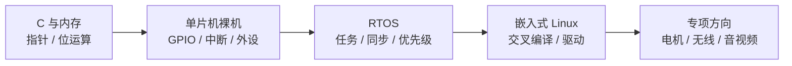

## 结论

嵌入式的主线只有一条：**C 语言与内存 → 单片机裸机 → RTOS → 嵌入式 Linux**。四段是递进的，跳段学必然卡住。

判断是否过关的标准不是"看完了多少教程"，而是**能不能独立做出一个东西，并解释清楚它为什么这样工作**。每一阶段下面都给了具体的验收物，达不到就不要往下走。

## 路线总览



| 阶段 | 典型周期 | 核心产出 |
| --- | --- | --- |
| C 与内存 | 3～4 周 | 能手写环形缓冲区、看懂 map 文件 |
| 单片机裸机 | 3～4 个月 | 三个独立小项目，能看波形调试 |
| RTOS | 1～2 个月 | 多任务采集系统，不踩优先级反转 |
| 嵌入式 Linux | 6 个月以上 | 交叉编译 + 开机自启 + 一个字符设备驱动 |

周期按每周 8～10 小时估算。全职投入可以压缩一半，但顺序不能变。

## 阶段一：C 语言与内存

Web 背景转嵌入式，卡点几乎都在这里，而且不是语法，是**心智模型**的差异：

- JavaScript 里访问越界数组得到 `undefined`，C 里得到别人的数据或者段错误；
- JS 的对象由 GC 管理，C 的变量在哪块内存、活多久，必须自己清楚；
- JS 里 `0.1 + 0.2` 只是精度问题，C 里还牵扯到整型提升、隐式截断、符号扩展。

必须吃透的六件事：

1. **指针与数组的区别**，包括指针算术、二级指针、函数指针；
2. **内存布局**：栈、堆、`.data`、`.bss`、常量区各放什么；
3. **位运算**：置位、清位、取反、判断，寄存器操作全靠它；
4. **`volatile`**：为什么中断里改的变量必须加，什么时候加也不管用；
5. **结构体对齐与 padding**：协议解析时算错长度是经典事故；
6. **编译与链接**：预处理、编译、汇编、链接四步，`.map` 文件怎么看。

验收物：手写一个无锁的单生产者单消费者环形缓冲区，用 `gcc -Wall -Wextra` 零警告通过，并能解释每一个字节在内存在哪里。

## 阶段二：单片机裸机

选一块板子就够，不要在选型上纠结超过一天。默认建议 **STM32F103**（资料最多、寄存器模型干净）或 **ESP32**（自带 WiFi，做物联网项目省事）。树莓派 Pico 也合适，但生态偏 Python，容易绕开底层。

必须掌握的顺序（不要跳）：

```
GPIO → 外部中断 → 定时器 → 串口 → I2C → SPI → DMA → ADC
```

每一步都要落到"能观测"的证据上：

- GPIO：按键中断 + 软件消抖，用逻辑分析仪看抖动窗口；
- 定时器：输出 PWM 做呼吸灯，改占空比看波形变化；
- 串口：自己写一个 `printf` 重定向，不依赖现成库；
- I2C：读一颗温湿度传感器，用分析仪看 ACK/NACK；
- SPI：驱动一块 OLED 或 Flash，读 ID 验证时序；
- DMA：串口 + DMA 连续采样，对比 CPU 占用。

**第一手资料是 Reference Manual 和 Datasheet，不是视频教程。** 教程告诉你"这样能跑"，手册告诉你"为什么必须这样"。养成先查手册对应章节、再看代码的习惯，这是嵌入式工程师和"板子玩家"的分水岭。

## 阶段三：RTOS

裸机能跑通之后再上 RTOS，否则你只是在用 RTOS 掩盖自己不懂硬件的事实。

以 **FreeRTOS** 入门最稳（代码量小、可读），工业界用得多；**Zephyr** 更现代但抽象层厚，**RT-Thread** 中文资料好。选一个，别三个都看。

要建立的概念，按重要性排序：

| 概念 | 为什么重要 | 典型事故 |
| --- | --- | --- |
| 任务与优先级 | 决定谁先跑 | 高优先级任务忙等，低优先级饿死 |
| 抢占与临界区 | 决定数据何时被改 | 忘了关中断，共享变量被撕裂 |
| 队列 / 信号量 | 任务间唯一的合法通信方式 | 用全局变量传数据，偶发丢包 |
| 优先级反转 | 互斥锁的真实陷阱 | 中优先级任务把高优先级卡住 |
| 栈空间估算 | 每个任务独立栈 | 栈溢出，表现为随机死机 |

验收物：三个任务——采集（定时）、处理（队列）、输出（串口）——加一个空闲钩子做低功耗休眠，连续跑 24 小时不死机。

## 阶段四：嵌入式 Linux

**先问自己是否真的需要。** 需要文件系统、网络协议栈、复杂 UI、多进程时，才上 Linux；单纯控制电机、读传感器，单片机更合适、成本更低。

这条路要分清两条线，很多人混在一起学，结果两头不靠：

- **应用线**：Linux 系统编程（进程、线程、IPC、socket）、交叉编译、开机自启；
- **BSP 线**：U-Boot、内核裁剪、设备树、字符设备驱动。

建议顺序：先在开发板上把应用跑通（交叉编译 + systemd 自启），再回头碰内核。驱动从最简单的字符设备开始，不要一上来就看子系统。

验收物：交叉编译一个自己的程序，打包进镜像并开机自启；写一个字符设备驱动，实现 `open/read/write/ioctl` 并在用户态验证。

## 专项方向

四个阶段走完只是"能干活"，深入要靠一个专项：

- **电机控制**：FOC、PID、编码器，对数学和实时性要求高；
- **无线与物联网**：BLE、LoRa、MQTT、低功耗设计；
- **音视频**：编解码、I2S、DMA 带宽，吃内存和算力；
- **汽车电子**：CAN/CAN FD、UDS 诊断、功能安全，门槛高但缺口大。

选一个做到能讲清楚取舍，比四个都浅尝更有价值。

## 易错点

- **只看视频不动手**。嵌入式是物理世界的技能，示波器和逻辑分析仪给出的信息，视频永远给不了。
- **不断换板子**。把一块板子的一个外设吃透，胜过五块板子各点一次灯。
- **跳过 C 直接上 RTOS**。RTOS 不教你内存模型，只会让错误更难定位。
- **迷信 HAL 库**。库可以用，但要知道它替你写了哪几个寄存器；出问题时没有手册兜底会非常被动。
- **省逻辑分析仪的钱**。几十块的工具能省掉几十小时的盲猜，这是整条路线上性价比最高的一笔投入。
- **用"学完某本书"当里程碑**。书没有终点，项目有。
