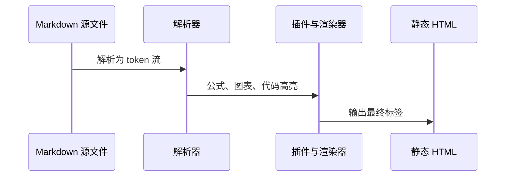

## 结论

一次构建是四段流水线：**读取与校验 → 解析为 token 流 → 插件转换 → 输出静态文件**。凡是能在构建阶段算完的东西，都不应该留给浏览器。

## 推导

### 阶段一：frontmatter 校验

构建开始前，先扫描内容目录，把每个 Markdown 文件的 frontmatter 解析成结构化数据，再用 schema 校验。

这一步的价值在于**把内容错误变成构建错误**。字段拼错、日期格式不对、必填项缺失，都会在这里失败，而不是在页面上留一块空白。

```ts
const schema = z.object({
  title: z.string().min(1).max(80),
  date: z.string().regex(/^\d{4}-\d{2}-\d{2}$/),
  topic: z.string().min(1),
  summary: z.string().min(20).max(200),
});
```

日期字段尤其容易出错：YAML 会把不加引号的 `2026-11-17` 解析成 Date 对象，写进 schema 前必须统一成字符串，否则校验规则和文件名对不上。

### 阶段二：解析为 token 流

Markdown 文本被解析成一串 token，而不是直接拼 HTML 字符串。此时还没有任何标签，只有结构：标题、段落、代码块、公式、链接。

有 token 流才有后续的插件介入空间——这也是为什么「用正则直接替换 Markdown」的做法一定会出问题。

### 阶段三：插件转换

插件按注册顺序处理 token：



顺序很重要：语法层面的扩展必须在渲染之前完成，输出层面的处理在之后。顺序颠倒通常不会报错，只是静默不生效。

### 阶段四：输出

每个页面渲染成一个 HTML 文件，资源打包成带哈希的静态文件。CDN 只需要按路径返回文件，没有任何计算。

## 复杂度视角

假设一篇文章有 $n$ 个代码块，高亮的朴素实现是每个代码块做一次词法分析，复杂度为 $O(n \cdot L)$，其中 $L$ 是代码长度。构建时完成意味着这笔开销只付一次，而不是每个读者付一次。

公式同理：MathJax 在构建时把 $\LaTeX$ 渲染成内联 SVG，浏览器只需要解析图片，不需要加载数学排版引擎。打开网络面板可以看到，公式没有产生任何额外请求。

## 易错点

- **在构建阶段做网络请求**。构建应该只依赖仓库内的文件，否则构建会随机失败，且无法复现。
- **插件顺序颠倒**。把渲染层的插件放在语法层之前，通常不会报错，只是静默不生效。
- **忽略死链检查**。站内链接写错不会让页面白屏，只会让读者点进 404；把死链检查设为构建失败，才能拦住这种问题。
- **图片不经处理直接进仓库**。构建产物会在半年内膨胀到几百 MB。

## 关联

- [为什么个人笔记站适合做成静态站点](/notes/web-architecture/2026-11-18-static-site-for-notes.md)
- [样式层怎么选：工具类、原生 CSS，还是框架自带主题](/notes/tooling/2026-11-16-tailwind-vs-vanilla-css.md)
