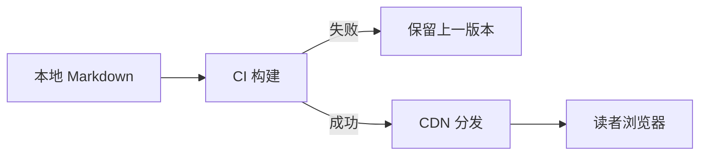

## 结论

学习笔记是**低频写入、高频读取、结构稳定**的内容。这类内容的最优解是静态生成：写作时是本地文件，发布时编译成 HTML，运行时不需要数据库和服务器。

代价是失去了实时评论、在线编辑和权限控制——对个人笔记来说，这三项都不重要。

## 推导

### 1. 失效模式更可控

动态站点出问题，通常是在线故障：数据库连接池耗尽、依赖升级导致运行时崩溃、被扫端口。静态站出问题，通常是构建失败——而构建失败发生在部署之前，线上仍然是上一个可用版本。

也就是说，**故障被前移到了可以安全失败的位置**。这是静态站最被低估的优点。

### 2. 长期成本接近零

| 项目 | 静态站 | 动态站 |
| --- | --- | --- |
| 服务器 | 无 | 需要，且有闲置成本 |
| 数据库备份 | 无 | 必须定期做 |
| 安全补丁 | 无运行时 | 框架、依赖、系统三层 |
| 迁移成本 | 换框架重编译 | 导出数据 + 重写查询 |

三年后的差异不在钱，在于**你是否还愿意继续维护它**。

### 3. 内容与呈现解耦

Markdown 文件是唯一的事实来源。站点框架只是它的一个渲染器，可以随时替换。判断标准很简单：删掉整个项目目录，只保留 `content/`，内容是否完好？静态站方案下答案是肯定的。

## 易错点

- **误以为静态站不能搜索**。全文索引可以在构建时生成，检索完全在浏览器里完成，不需要后端。
- **把图片放在第三方图床**。图床会失效，而笔记的生命周期通常比图床长。图片应与 Markdown 同目录、一起进版本库。
- **在内容里写相对链接**。相对链接按文件位置解析，笔记换目录就会断；统一用 `/notes/<主题>/<短名>.md` 的绝对路径，部署时的 base 前缀由构建自动补全。

## 关联

- [渲染管线：从 Markdown 到 HTML 发生了什么](/notes/web-architecture/2026-11-17-render-pipeline.md)
